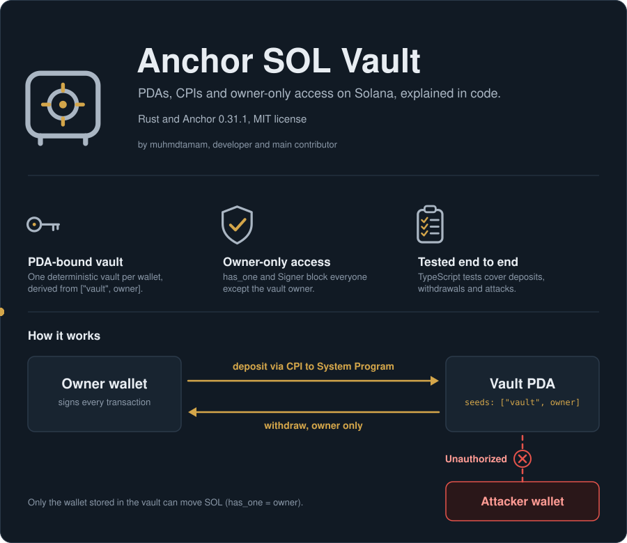

<p align="center">
  
</p>

<div align="center">

**[Overview](#overview) · [How it works](#how-it-works) · [Prerequisites](#prerequisites) · [Setup](#setup) · [Tests](#run-the-tests) · [Deploy](#deploy-to-devnet) · [Contributing](#contributing)**

</div>

---

## Overview

A small, heavily commented Solana program that teaches **Program Derived Addresses (PDAs)**, **CPIs**, and **authorization constraints** with the [Anchor](https://www.anchor-lang.com/) framework.

Each wallet can create one vault, deposit SOL into it, and withdraw SOL from it. Nobody else can touch it.

**Author:** muhmdtamam, developer and main contributor.

## How it works

The diagram at the top shows both money flows and a rejected attacker.

| Instruction | What it does | Who can call it |
| ----------- | ------------ | --------------- |
| `initialize` | Creates the vault PDA and stores the owner and canonical bump | Any wallet (for its own vault only) |
| `deposit` | Moves SOL from the owner's wallet into the vault (CPI to System Program) | Vault owner |
| `withdraw` | Moves SOL from the vault back to the owner | Vault owner |

The vault address is derived from fixed seeds, so every user has exactly one:

```
vault = PDA(["vault", owner_pubkey], program_id)
```

### Security model

- **PDA verification**: `seeds` + `bump` re-derive the address, so a fake account can't pose as a vault.
- **Owner-only access**: `has_one = owner` plus the `Signer` type means the transaction must be signed by the wallet stored in the vault. Failure returns `VaultError::Unauthorized`.
- **Rent protection**: withdrawals can't dip into the rent-exempt reserve (`VaultError::InsufficientFunds`).
- **Checked math**: lamport arithmetic uses `checked_add` / `checked_sub`.
- **Input validation**: zero amounts are rejected (`VaultError::InvalidAmount`).

### Why withdraw edits lamports directly

`deposit` uses a CPI to the System Program. `withdraw` can't: `system_program::transfer` only debits accounts that are owned by the System Program and hold no data, while the vault is owned by this program and stores data. A program *is* allowed to debit accounts it owns and credit any writable account, so the handler adjusts lamports itself. The runtime still enforces that total lamports stay balanced.

### Errors

| Code | Name | Meaning |
| ---- | ---- | ------- |
| 6000 | `Unauthorized` | Signer is not the vault owner |
| 6001 | `InvalidAmount` | Amount is zero |
| 6002 | `InsufficientFunds` | Amount exceeds the withdrawable balance |
| 6003 | `MathOverflow` | Arithmetic overflow |

### Project layout

```
.
├── Anchor.toml                  # Anchor workspace + cluster config
├── Cargo.toml                   # Rust workspace
├── package.json / tsconfig.json # TypeScript test tooling
├── assets/overview.svg          # Animated header image used by this README
├── programs/vault/
│   ├── Cargo.toml
│   └── src/lib.rs               # The program
└── tests/vault.ts               # Integration tests
```

## Prerequisites

| Tool | Version used here | Install |
| ---- | ----------------- | ------- |
| Rust | stable | https://rustup.rs |
| Solana CLI (Agave) | 2.1.x or newer | https://solana.com/docs/intro/installation |
| Anchor (via `avm`) | 0.31.1 | https://www.anchor-lang.com/docs/installation |
| Node.js | 18+ | https://nodejs.org |
| Yarn | 1.x | `npm i -g yarn` |

```bash
avm install 0.31.1
avm use 0.31.1
anchor --version   # anchor-cli 0.31.1
```

> [!NOTE]
> The code targets Anchor **0.31.1**. Newer Anchor releases changed some APIs (for example `CpiContext::new`), so keep the version pinned if you want it to compile as-is.

## Setup

```bash
git clone <your-fork-url> anchor-sol-vault
cd anchor-sol-vault

# 1. Create a local wallet if you don't have one (used as fee payer / deployer)
solana-keygen new --outfile ~/.config/solana/id.json

# 2. Install JS dependencies
yarn install

# 3. Build once so Anchor generates the program keypair and IDL
anchor build

# 4. Make declare_id! and Anchor.toml match that keypair, then rebuild
anchor keys sync
anchor build
```

> [!IMPORTANT]
> Step 4 matters: the program ID in `declare_id!` must equal the address of `target/deploy/vault-keypair.json`. If they differ, calls fail with `DeclaredProgramIdMismatch` (error 4100). Each fork should run `anchor keys sync` to get its own program ID.

## Run the tests

```bash
anchor test
```

This starts a local validator, deploys the program, and runs `tests/vault.ts`. The tests verify that:

1. a vault PDA is initialized and bound to its owner,
2. deposits move the exact amount into the vault,
3. the owner can withdraw,
4. a withdrawal or deposit signed by another wallet fails with `Unauthorized` and changes no balances,
5. zero amounts fail with `InvalidAmount`,
6. over-withdrawing (including the rent reserve) fails with `InsufficientFunds`,
7. the owner can withdraw everything above the rent-exempt reserve.

To run against a validator you started yourself:

```bash
solana-test-validator            # in another terminal
anchor test --skip-local-validator
```

## Deploy to devnet

```bash
solana config set --url devnet
solana airdrop 2                 # repeat if needed; deployment costs a few SOL
anchor build
anchor keys sync
anchor build
anchor deploy --provider.cluster devnet
```

Check the deployment:

```bash
solana program show $(solana address -k target/deploy/vault-keypair.json)
```

## Troubleshooting

<details>
<summary><b>Common problems and fixes</b></summary>

<br>

| Symptom | Fix |
| ------- | --- |
| `DeclaredProgramIdMismatch` (4100) | Run `anchor keys sync`, then `anchor build` |
| `lock file version 4 requires -Znext-lockfile-bump` | Your Solana toolchain's Cargo is older than the lockfile format. Change `version = 4` to `version = 3` at the top of `Cargo.lock`, or upgrade the Solana CLI |
| Cannot find module `../target/types/vault` | Run `anchor build` first; it generates the IDL types |
| Airdrop rate-limited on devnet | Wait and retry, or use a faucet such as https://faucet.solana.com |

</details>

## Ideas for extending it

- A `close` instruction that returns the rent-exempt reserve and closes the vault.
- Emit events (`#[event]`) on deposit and withdraw for indexers.
- Allow third parties to deposit while keeping withdrawals owner-only.
- SPL token vaults using associated token accounts and PDA-signed CPIs (`CpiContext::new_with_signer`).

## Contributing

Contributions are welcome. Whether it's a bug fix, better comments, or a new example, here's how to send it:

1. Fork the repository and create a branch: `git checkout -b feature/my-change`
2. Make your changes and add or update tests in `tests/vault.ts`.
3. Run `anchor test` and make sure everything passes.
4. Open a pull request describing what you changed and why.

Since this repo is meant for learning, keep comments short and clear.

## Credits

- **muhmdtamam**: developer and main contributor.
- Everyone who sends issues, ideas, and pull requests.

Built with [Anchor](https://www.anchor-lang.com/) on [Solana](https://solana.com/).

## License

Released under the MIT License. See [LICENSE](./LICENSE).

Copyright (c) 2026 muhmdtamam 
